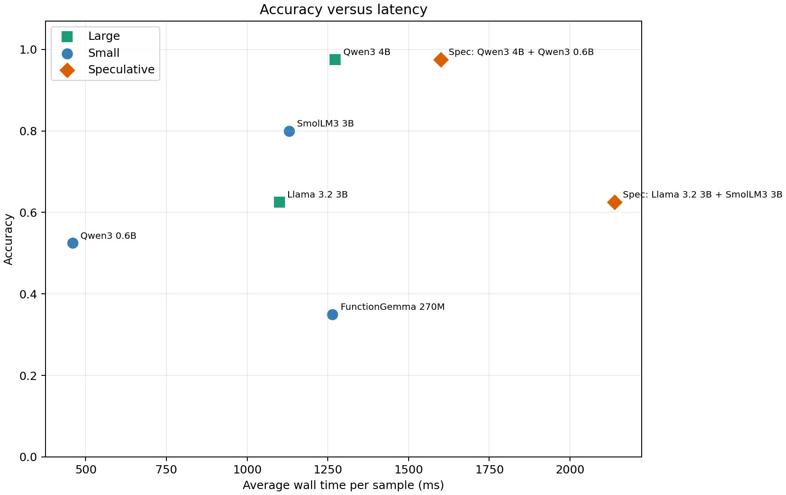

# Speculative decoding with MLX

A personal experiment by Chakib Belgaid comparing a small model, a larger target model, and draft-and-verify speculative decoding on Apple Silicon. The workload is short JSON classification of fictional speakers, explored for [Whispbook](https://github.com/chakib-belgaid/whispbook).

**Result: no speedup in the recorded experiment.** The Qwen speculative pair matched the target's predictions on the tested samples but took more wall-clock time. Model loading happens inside each timed inference call, so these measurements include setup and do not isolate steady-state decoding performance.

## Recorded results

The archived June 2, 2026 matrix contains **40 unique labeled samples across five synthetic stories**. Its 680 prediction rows include multiple configurations and repeated standalone baselines; they are not 680 independent samples.

| Configuration | Accuracy | Mean wall time | Median wall time | Mean output tokens | Draft acceptance |
| --- | ---: | ---: | ---: | ---: | ---: |
| Qwen3 4B target only | 97.5% | 1,247 ms | 1,106 ms | 29.9 | — |
| Qwen3 4B + Qwen3 0.6B draft | 97.5% | 1,599 ms | 1,561 ms | 29.9 | 75.6% |

The speculative path was **28.3% slower in this protocol**. Short outputs and per-call model setup are important confounders; the experiment does not identify their individual contributions or establish how speculative decoding performs on longer outputs or a warmed-up serving system.

- [Full comparative report](docs/story_model_matrix_experiment/comparative_report.md)
- [Timing limitations and next experiment](docs/story_model_matrix_experiment/speculative_qwen_latency_conclusion.md)
- [Row-level results](docs/story_model_matrix_experiment/tables/story_model_matrix_predictions.csv)
- [Summary tables and charts](docs/story_model_matrix_experiment/README.md)



## What is implemented

- MLX-LM inference through `mlx_lm.stream_generate(..., draft_model=...)`.
- `small_only`, `large_only`, and `speculative` comparison modes.
- Hugging Face checkpoint discovery with local-cache and remote-ID support.
- Structured JSON parsing, accuracy, parse success, wall time, and draft-token statistics.
- Story fixtures, PDF-to-text preparation tools, notebooks, and report generation.

The main pair is `mlx-community/Qwen3-4B-Instruct-2507-4bit` with `mlx-community/Qwen3-0.6B-4bit` as draft. The matrix also explores other model families; not every pairing is supported. A vocabulary-size check is only a basic guard, not a complete tokenizer-compatibility proof.

## Setup and checks

Live inference requires macOS on Apple Silicon. Use Python 3.12 and [uv](https://docs.astral.sh/uv/). MLX-LM is pinned to `0.31.3` in the development dependencies.

```bash
uv sync --frozen
uv run --frozen pytest -q -m "not live"
uv run --frozen python scripts/validate_story_fixtures.py data/story_2 data/story_3 data/story_4 data/story_5
```

Inspect checkpoint candidates without running inference:

```bash
uv run --frozen gender-specdec --list-checkpoints
uv run --frozen gender-specdec --list-checkpoints --local-only
```

## Run an experiment

The first live run may download model weights from Hugging Face.

```bash
uv run --frozen gender-specdec --benchmark --benchmark-limit 8 --max-tokens 64
```

Run a custom story fixture and save the row-level results:

```bash
uv run --frozen gender-specdec \
  --benchmark \
  --ground-truth data/story_1/glass_archive_speaker_attribution_ground_truth.jsonl \
  --story-text data/story_1/glass_archive_20000_word_story.txt \
  --metadata data/story_1/glass_archive_benchmark_metadata.json \
  --small-family qwen_small \
  --large-family qwen_large \
  --max-tokens 64 \
  --num-draft-tokens 7 \
  --output-csv results/glass_archive_benchmark.csv
```

An opt-in live test loads locally available checkpoints:

```bash
RUN_LIVE_MLX_GENDER=1 uv run --frozen pytest -q tests/test_live_mlx_gender_inference.py -s
```

## Explore the notebooks and archived data

- [Walkthrough](notebooks/speculative_decoding_walkthrough.ipynb): paper background, model comparisons, and optional PDF-to-chapter experiment.
- [Benchmark analysis](notebooks/benchmark_analysis.ipynb): story and model comparisons.

Notebook live inference is disabled by default. To enable it, set `RUN_LIVE_MLX_GENDER=1` before launching the kernel. For the PDF walkthrough, replace `data/your-own-book.pdf` with your input file. Saved notebook outputs are cleared in this public snapshot; the archived CSVs, reports, and charts remain available.

```bash
uv run --frozen --with jupyterlab jupyter lab notebooks/speculative_decoding_walkthrough.ipynb
```

Regenerate the report from the included CSV without loading models:

```bash
uv run --frozen python scripts/generate_story_model_matrix_report.py \
  --csv docs/story_model_matrix_experiment/tables/story_model_matrix_predictions.csv \
  --report results/comparative_report.md \
  --assets-dir results/assets
```

Personal filesystem prefixes in the archived CSVs have been replaced with relative paths and `<HF_CACHE>`; model snapshot revisions and measured values are retained. These results are historical observations, not a fresh run on every checkout. Complete hardware and runtime metadata were not captured, which also limits exact reproduction.

## Measurement limits and next steps

The current runner loads models inside each sample's timed call. It has no steady-state warmup protocol, repeated timing trials, or confidence intervals. Matching predictions in this small sample does not establish general equivalence of output distributions.

A follow-up speed experiment should load models once, warm them up, separate prefill and decoding from setup, repeat trials, and compare short and long generations. The present implementation is an exploratory integration and evaluation prototype, not a production serving benchmark.

## Data and references

The `data/story_1` through `data/story_5` directories contain generated fictional stories and character labels. The separate built-in smoke test uses short excerpts from Henrik Ibsen's [A Doll's House, Project Gutenberg #2542](https://www.gutenberg.org/ebooks/2542), with source metadata in the code. No personal PDF or model weights are included.

- Leviathan, Kalman, and Matias, [Fast Inference from Transformers via Speculative Decoding](https://arxiv.org/abs/2211.17192).
- Chen et al., [Accelerating Large Language Model Decoding with Speculative Sampling](https://arxiv.org/abs/2302.01318).
- [MLX-LM](https://github.com/ml-explore/mlx-lm).
